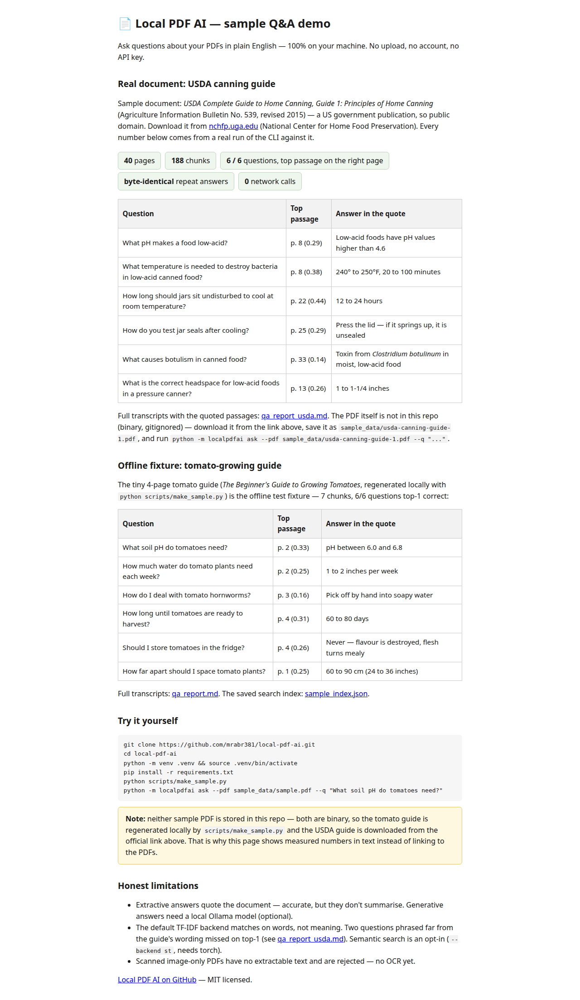
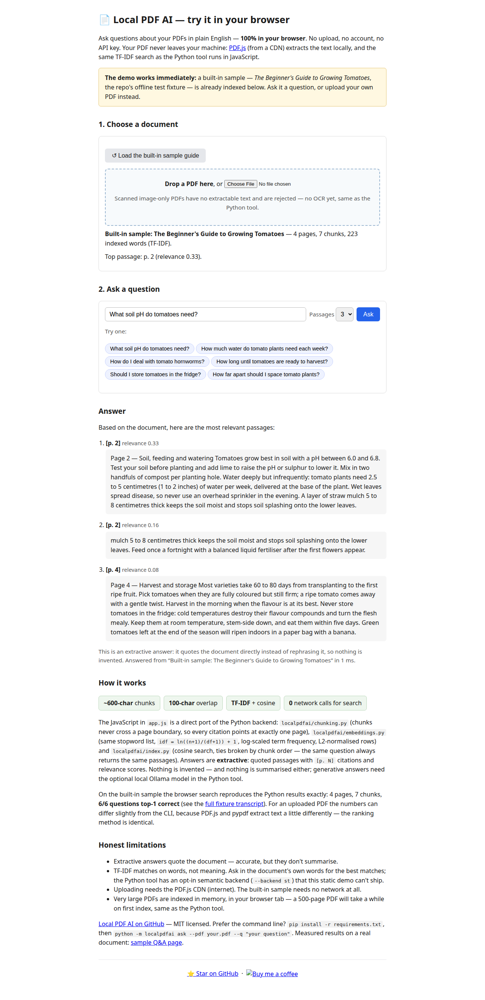
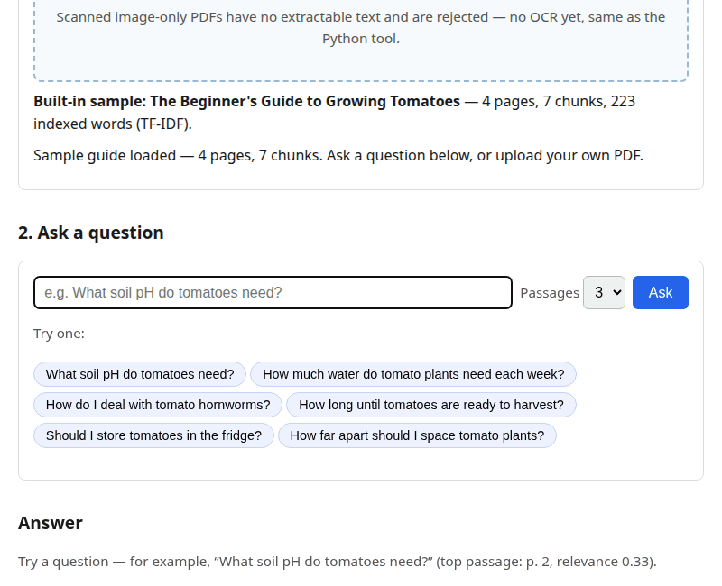

# 📄 Local PDF AI

[](https://github.com/mrabr381/local-pdf-ai/actions/workflows/ci.yml)


[](https://github.com/mrabr381/local-pdf-ai) [](https://www.buymeacoffee.com/muhammadabubakar)

**Ask questions about your PDFs in plain English — and get answers with page citations.** Everything runs on your machine: no upload, no account, no API key, no subscription. Drop in a contract, a manual, a research paper, a textbook — ask "what is the notice period?" and get the exact passage, with the page number, in seconds.

> **▶ Live demo:** [try it in your browser](https://mrabr381.github.io/local-pdf-ai/demo/) — upload any PDF and ask it questions, or try the built-in sample with one click. No upload, no account, no API key; everything runs in your browser. The measured results behind it — real questions asked of a real government guide — are on the [sample Q&A page](https://mrabr381.github.io/local-pdf-ai/sample_output/) (GitHub Pages). Or run the web app yourself: `streamlit run app.py` — 1-click deploy on Streamlit Community Cloud (share.streamlit.io → Create app → repo `mrabr381/local-pdf-ai`, file `app.py` → Deploy; no key needed).


*Screenshot of the live sample Q&A page — real questions asked of the USDA Complete Guide to Home Canning, 6/6 answered with the right page cited.*


*Screenshot — asking "What soil pH do tomatoes need?" of the built-in tomato guide: top passage p. 2, relevance 0.33, with two more cited passages.*


*GIF — typing the soil-pH question and the cited answer appearing.*

## A real document, really questioned

Sample: *USDA Complete Guide to Home Canning, Guide 1: Principles of Home Canning* (Agriculture Information Bulletin No. 539, revised 2015) — a US government publication, so public domain. 40 pages, 188 chunks, TF-IDF backend. Top-1 citation correct on **6/6**:

| Question | Top passage | Answer in the quote |
| --- | --- | --- |
| What pH makes a food low-acid? | p. 8 (0.29) | Low-acid foods have pH values higher than 4.6 |
| What temperature is needed to destroy bacteria in low-acid canned food? | p. 8 (0.38) | 240° to 250°F, 20 to 100 minutes |
| How long should jars sit undisturbed to cool at room temperature? | p. 22 (0.44) | 12 to 24 hours |
| How do you test jar seals after cooling? | p. 25 (0.29) | Press the lid — if it springs up, it is unsealed |
| What causes botulism in canned food? | p. 33 (0.14) | Toxin from *Clostridium botulinum* in moist, low-acid food |
| What is the correct headspace for low-acid foods in a pressure canner? | p. 13 (0.26) | 1 to 1-1/4 inches |

Full transcripts: [`sample_output/qa_report_usda.md`](sample_output/qa_report_usda.md). The PDF itself is **not in this repo** (binary, gitignored) — download it from <https://nchfp.uga.edu/papers/guide/GUIDE01_HomeCan_rev0715.pdf> (National Center for Home Food Preservation, the official publisher of the electronic edition), save it as `sample_data/usda-canning-guide-1.pdf`, and ask away. Same question twice returns byte-identical output.

The tiny offline fixture — a 4-page tomato-growing guide regenerated by `python scripts/make_sample.py` — still ships with the repo for offline testing, and scores 6/6 too (full transcript: [`sample_output/qa_report.md`](sample_output/qa_report.md)).

## Quickstart

```
git clone https://github.com/mrabr381/local-pdf-ai.git
cd local-pdf-ai
python -m venv .venv && source .venv/bin/activate   # Windows: .venv\Scripts\activate
pip install -r requirements.txt

# Make the sample PDF and ask it something:
python scripts/make_sample.py
python -m localpdfai ask --pdf sample_data/sample.pdf --q "What soil pH do tomatoes need?"
```

## Usage

```
# Build a reusable index (fast after the first ask)
python -m localpdfai index --pdf contract.pdf
# → contract.localpdfai.json

# Ask questions (reuses the index when it exists)
python -m localpdfai ask --pdf contract.pdf --q "what is the notice period?"
python -m localpdfai ask --pdf manual.pdf --q "how do I reset the device?" --top-k 5
```

Exit codes: `0` ok, `1` runtime error (missing file, no extractable text, empty question, Ollama unreachable in `--llm ollama` mode), `2` bad arguments. Errors are plain-English, no tracebacks. Web app: `streamlit run app.py` — upload a PDF, ask in the chat box, expand any passage to see the full text with its page number. Nothing is uploaded anywhere.

## How it works

PDF → pypdf (text per page) → chunks (~600 chars, never crossing a page boundary, so every citation points at exactly one page) → TF-IDF embeddings (NumPy, default) or sentence-transformers (`--backend st`, optional) → cosine search, top-k passages → extractive answer: quoted passages + `[p. N]` citations. Retrieval is deterministic: ties break by chunk order, so the same question always returns the same passages. Index files (`*.localpdfai.json`) are plain JSON and rebuildable any time.

**Optional — generative answers with Ollama:** run `ollama serve` + `ollama pull llama3.2`, then `--llm auto` (falls back to extractive when Ollama isn't running) or `--llm ollama` (fails loudly). The model only ever sees the retrieved passages, never the whole document.

## Comparison

| | Local PDF AI | Paid PDF-chat tools |
|---|---|---|
| Price | Free, open source (MIT) | Subscription, usually per month |
| Documents uploaded to a server? | No — everything local | Yes, by design |
| Account / API key needed | No | Yes |
| Answers with page citations | Yes | Yes |
| Generative summaries | Yes, with local Ollama (optional) | Yes, cloud LLM |
| Works offline | Yes (after install) | No |

## Honest limitations

- **Extractive answers are quotes, not synthesis.** Without Ollama you get exact passages — accurate, but no polished summary. Deliberate: it cannot invent facts.
- **TF-IDF is lexical, not semantic.** A question phrased very differently from the document may miss — e.g. "What is headspace?" lands on the contents page instead of the definition, and "How should canned jars be stored?" misses the storage guidance entirely. Asking in the document's own words fixes the first; use `--backend st` for paraphrase-heavy questions.
- **No OCR.** Scanned image-only PDFs have no extractable text and are rejected with a clear error.
- **Ollama answers depend on your local model** — a small model can still misread a passage; always check the cited page. **Large PDFs are slower on first index** — in-memory, single-threaded; a 500-page PDF takes a few minutes first time, then the saved index makes later asks instant.

## Tests

```bash
pip install pytest
python -m pytest   # Q&A citation maths: pH question top-1 p.2 at 0.33, 6/6 fixture questions
```

CI runs pytest on every push (see the badge at the top).

```
local-pdf-ai/
├── app.py                  # Streamlit web app (repo root, deploy-ready)
├── localpdfai/             # pdfio, chunking, embeddings, index, answer, cli
├── scripts/make_sample.py  # regenerates the tomato fixture PDF (reportlab)
├── sample_data/            # sample.pdf (generated, gitignored) + USDA guide (local only)
└── sample_output/          # qa_report.md (fixture) + qa_report_usda.md + demo page
```

MIT — see [LICENSE](LICENSE).
